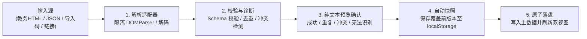

# 「简课表查看」可行性分析与架构设计（V1 定稿版）

## 1. 逐项可行性分析与技术边界

| 模块 | 可行性结论 | 关键技术约束与风险 | V1 工程落地方案 |
| :--- | :--- | :--- | :--- |
| **纯静态 PWA 与 iPhone 独立窗口离线** | **完全可行** | 1. 非 `localhost` 的 HTTP（如局域网 IP）不是安全上下文，浏览器会拒绝注册 SW。<br>2. iOS Safari 与主屏幕 Web App 使用**相互隔离**的 `localStorage` 与 Cache Storage。<br>3. 长期未访问时 Safari 存在存储回收策略，需提供备份兜底。 | 1. 电脑 `localhost` 调试，手机真机离线验收使用可信 **HTTPS**（GitHub Pages / Cloudflare Pages / mkcert）。<br>2. 界面明确引导：**先添加到主屏幕 → 打开主屏幕 App → 等待「已可离线使用」提示 → 在主屏幕 App 内导入课表**。<br>3. 提供一键完整 JSON 导出作为跨设备与防清理兜底。 |
| **教务课表导入** | **有条件可行**（须收缩宣称边界） | 1. 动态 SPA 教务系统直接「查看网页源码」常为空壳 HTML，无课程 DOM。<br>2. 跨域 `iframe` 受同源策略（SOP）限制，JS 无法访问 `contentDocument`。<br>3. Chrome 控制台默认启用 Self-XSS 防护（需输入 `allow pasting`），普通用户门槛较高。<br>4. 直接渲染外部粘贴 HTML 存在 XSS 风险。 | 1. 仅宣称支持**已验证页面结构**及**同源可访问 iframe** 的已渲染 DOM 表格。<br>2. 首批基于**1 份脱敏真实样本**编写并测试专属适配器，辅以通用表格解析与手动录入。<br>3. 控制台脚本 / 书签降级为「高级入口」并附粘贴提示。<br>4. 粘贴 HTML 仅通过 `DOMParser().parseFromString(html, 'text/html')` 在隔离文档中解析（不执行脚本、不发网络请求），预览层仅以 `textContent` 渲染纯文本。 |
| **电脑传手机（发送课表 / 导入副本）** | **完全可行** | 1. `#schedule=...` 虽不随 HTTP 请求发给托管服务器，但持有完整链接即可解码，且经微信/聊天软件发送时会经过通信渠道，不能宣称「绝对端到端私密」。<br>2. 微信内点开链接会落在微信内置浏览器或 Safari，无法直接写入 iOS 主屏幕 App 的独立存储；长链接也可能被截断。 | 1. 功能改名为**「发送课表 / 导入副本」**并如实提示隐私边界。<br>2. 首版提供三层互补途径：**JSON 备份文件（主推，主屏幕 App 内最稳）** + **复制导入码（`JKB1:...`，免文件中转、直接在主屏幕 App 粘贴）** + **`#schedule=JKB1:...` 压缩链接（快捷入口）**。<br>3. 压缩使用浏览器原生 `CompressionStream('deflate-raw')`（带纯 UTF-8 Base64URL 降级），体积超阈值自动提示改用 JSON 文件。 |
| **统一实际课次引擎（含单双周与调停课）** | **完全可行** | 若今日视图、周视图、`.ics` 导出各写一套周次判断，遇到单双周、临时停课、补课或换教室必然出现不一致。 | 确立**单一事实来源（Single Source of Truth）**：底层存学期配置、作息表、课程组规则与按日期例外（`overrides`），由纯函数统一展开指定日期/周/学期的实际课次，三处视图和导出严格复用同一输出。 |
| **`.ics` 日历导出** | **首版完全可行**（导入放 V2） | 1. 各大日历客户端对 `RRULE` + `EXDATE` + 单双周组合兼容性差异大。<br>2. Google Calendar 官方文件导入入口在电脑端；iOS 导入及提醒效果需真机验证。 | 首版将整学期实际课次直接展开为独立 `VEVENT`（稳定确定性 `UID` + 精确本地时区时间 + 可选 `VALARM`），天然兼容单双周、停课、补课、换教室；界面中明示不同平台日历导入路径差异。 |
| **Service Worker 原子更新** | **完全可行** | 若无版本控制或提前 `skipWaiting()` 混用旧 HTML 与新 JS，可能导致升级瞬间白屏或模块报错。 | 采用版本化核心清单（`jkb-shell-vX.Y.Z`）：`install` 阶段预缓存整套启动资源全部成功才进入 `installed`；首次安装自动激活并通知前端「已可离线使用」；后续升级待用户点击刷新后再激活切换，避免混用跨版本资源。 |

### 本地环境核查结论

当前开发机已具备：`git 2.54.0`、`Python 3.9.6`、`Node v26.13.1`。
- `src/` 保持 **0 构建依赖**的原生 HTML5 / CSS3 / ES Modules，可直接部署到任意静态托管平台。
- `tests/` 可直接使用 Node 内置 `node:test` 与 `node:assert` 对核心计算引擎、导入解析与 `.ics` 生成进行自动化回归测试，无需引入第三方构建链或 `node_modules`。

---

## 2. 核心数据模型（Schema v1）

所有持久化（`localStorage`）、JSON 备份与「发送课表」副本共用同一份带版本号的数据结构：

```json
{
  "schemaVersion": 1,
  "updatedAt": "2026-11-22T13:45:00.000Z",
  "term": {
    "name": "2026-2027 学年第一学期",
    "startMonday": "2026-09-07",
    "totalWeeks": 20,
    "timezone": "Asia/Shanghai",
    "nextTermStartDate": ""
  },
  "periods": [
    { "index": 1, "start": "08:15", "end": "08:55" },
    { "index": 2, "start": "08:55", "end": "09:35" }
  ],
  "courses": [
    {
      "id": "crs_math_01",
      "name": "高等数学 A(上)",
      "teacher": "张明远",
      "location": "理学楼 302",
      "note": "",
      "colorSeed": "crs_math_01",
      "schedules": [
        {
          "ruleId": "r_1",
          "dayOfWeek": 1,
          "startPeriod": 1,
          "endPeriod": 2,
          "weeks": [1, 2, 3, 4, 5, 6, 7, 8, 9, 10, 11, 12, 13, 14, 15, 16]
        }
      ]
    }
  ],
  "overrides": [
    {
      "id": "ov_01",
      "type": "cancel",
      "courseId": "crs_math_01",
      "ruleId": "r_1",
      "date": "2026-10-05",
      "reason": "国庆放假"
    },
    {
      "id": "ov_02",
      "type": "modify",
      "courseId": "crs_math_01",
      "ruleId": "r_1",
      "date": "2026-11-23",
      "patch": {
        "startPeriod": 3,
        "endPeriod": 4,
        "location": "教三 105",
        "note": "临时调教室"
      }
    },
    {
      "id": "ov_03",
      "type": "add",
      "courseId": "crs_math_01",
      "date": "2026-10-10",
      "startPeriod": 1,
      "endPeriod": 2,
      "location": "理学楼 302",
      "teacher": "张明远",
      "note": "调休补周一课程"
    }
  ]
}
```

### 关键设计约束

1. **同一门课颜色按 `course.id` 固定**：通过确定性哈希将 `course.id` 映射到预设护眼调色板（浅色/深色双套对比度验证），增删其他课程不会导致已有课程变色。
2. **「仅此一次」与「整组课程」编辑语义**：
   - **仅此一次**：向 `overrides` 写入/合并一条对应 `date` 的 `modify` 或 `cancel` 记录（新增单次补课写入 `add`），不影响该课程其他周。
   - **整组课程**：修改 `courses` 中对应课程或 `schedules` 规则，立即可见于所有未单独覆写的周次。
3. **13 节作息可增减**：`periods` 为有序数组，默认初始化为浙江经贸职业技术学院官方作息（13 节/天；上午 1–5 节、下午 6–9 节、晚上 10–13 节；每节 40 分钟）；支持新增第 14/15 节或删减末尾节次（删除前检查是否有课程引用该节次并提示）。默认模板如下（与该校正方教务个人课表「时间段」分段的 5/4/4 结构一致）：

   ```json
   "periods": [
     { "index": 1,  "start": "08:15", "end": "08:55" },
     { "index": 2,  "start": "08:55", "end": "09:35" },
     { "index": 3,  "start": "09:55", "end": "10:35" },
     { "index": 4,  "start": "10:35", "end": "11:15" },
     { "index": 5,  "start": "11:20", "end": "12:00" },
     { "index": 6,  "start": "13:30", "end": "14:10" },
     { "index": 7,  "start": "14:10", "end": "14:50" },
     { "index": 8,  "start": "15:10", "end": "15:50" },
     { "index": 9,  "start": "15:50", "end": "16:30" },
     { "index": 10, "start": "17:40", "end": "18:20" },
     { "index": 11, "start": "18:20", "end": "19:00" },
     { "index": 12, "start": "19:10", "end": "19:50" },
     { "index": 13, "start": "19:50", "end": "20:30" }
   ]
   ```

   课间规律：2→3 节与 7→8 节之间为大课间 20 分钟；1→2、3→4、6→7、8→9、10→11、12→13 节连堂无休息；4→5 节间 5 分钟；11→12 节间 10 分钟；午休 12:00–13:30，晚课 17:40 开始。数据来源：学校《教学作息时间》官方附件（2026-03-04 起全校统一执行，取消此前按教学楼分两组、相差 15 分钟的做法）；若今后学期微调，只需改这一处默认值。
4. **学期状态计算规则**：
   - `today < term.startMonday`：显示「距离开学还有 N 天」（允许自由翻看第 1~N 周）。
   - `startMonday <= today <= termEndSunday`：正常显示「第 W 周」。
   - `today > termEndSunday`：显示「本学期已结束」；仅当配置了合法的 `nextTermStartDate` 且 `today < nextTermStartDate` 时，额外显示「距离下学期开学还有 M 天」。
5. **统一实际课次输出（Occurrence）**：
   - `resolveOccurrencesForDate(data, dateStr)`：返回指定日期（按 `term.timezone` 计算）按 `startPeriod` 排序的实际课次数组，每项包含 `occurrenceKey`、`date`、`week`、`courseId`、`name`、`teacher`、`location`、`startPeriod`、`endPeriod`、`startTime`、`endTime`、`source`（`rule` / `modified` / `added`）、`note`。
   - `resolveOccurrencesForWeek(data, weekNum)`：连续调用 7 天 `resolveOccurrencesForDate`。
   - `resolveAllTermOccurrences(data)`：覆盖学期起止周及所有落在该区间外的 `add` 补课日期，直接供 `.ics` 导出使用。

---

## 3. 统一导入与恢复管线

所有外部数据入口（教务样本解析、通用表格解析、JSON 备份文件、导入码、`#schedule=...` 链接）均必须经过同一条 5 步管线：



- **预览清单四类分组**：
  1. **识别成功**（可直接写入的规范课程 / 例外 / 设置）
  2. **重复条目**（同课程同星期同节次同周次，默认自动去重合并并告知）
  3. **时间冲突**（同周同天节次重叠的不同课程，高亮标出，允许保留或导入后手动调整）
  4. **无法识别 / 跳过项**（附原始纯文本片段和原因，方便用户对照手动补录）
- **覆盖保护与一键撤回**：每次覆盖导入前，将当前完整状态写入 `jkb_backup_snapshot_v1`，导入完成后在设置与导入页提供「恢复到导入前快照」按钮。

---

## 4. Service Worker 离线与更新状态机

1. **核心资源清单（App Shell）**：`./index.html`、`./styles.css`、`./manifest.webmanifest`、所有 `./js/*.js` 及图标文件统一绑定版本号 `CACHE_VERSION`。
2. **安装与离线就绪信号**：
   - SW 在 `install` 阶段原子缓存全部核心资源（任一失败则本次安装中止，不破坏旧版）。
   - 前端页面通过校验 `navigator.serviceWorker.controller` 与目标缓存完整性，在界面顶部/设置页明确显示状态徽章：
     - `已可离线使用（v1.0.0）`
     - `仅在线预览（当前非 HTTPS 或浏览器未启用离线缓存）`
3. **无撕裂更新**：
   - 发现新 SW 进入 `waiting` 状态时不强行静默替换，显示轻提示「发现新版本，点击更新」；用户确认后发送 `SKIP_WAITING` 并在 `controllerchange` 后整页重载，确保 HTML 与 JS 始终版本一致。

---

## 5. V1 开发分步计划（准备就绪后执行）

1. **Step 1 — 数据层与核心引擎**（`src/js/model.js`、`src/js/engine.js`、`src/js/storage.js` + `tests/engine.test.mjs`）：实现 Schema v1、实际课次计算、单双周与调停课例外、快照撤回，并全部通过单元测试。
2. **Step 2 — 统一导入/恢复与 `.ics` 导出**（`src/js/importers.js`、`src/js/transfer.js`、`src/js/ics.js` + `tests/import-ics.test.mjs`）：实现隔离 HTML 解析、脱敏真样本教务适配器、通用表格兜底、JSON/导入码/`#schedule=` 编解码、展开式 `.ics` 导出。
3. **Step 3 — 极简响应式双视图 UI 与交互**（`src/index.html`、`src/styles.css`、`src/js/app.js`）：实现今日视图、周视图、「仅此一次/整组」编辑弹窗、可增减作息编辑器、导入预览弹窗、安装引导与离线状态提示。
4. **Step 4 — PWA 资源与原子更新 SW**（`src/manifest.webmanifest`、`src/sw.js`、`src/icons/*`）：生成 PNG/SVG 图标，验证离线缓存与版本更新流程。
5. **Step 5 — 本地预览与三项上线走查**：按 `docs/acceptance-checklist.md` 完成自动化测试与真机验收准备。
